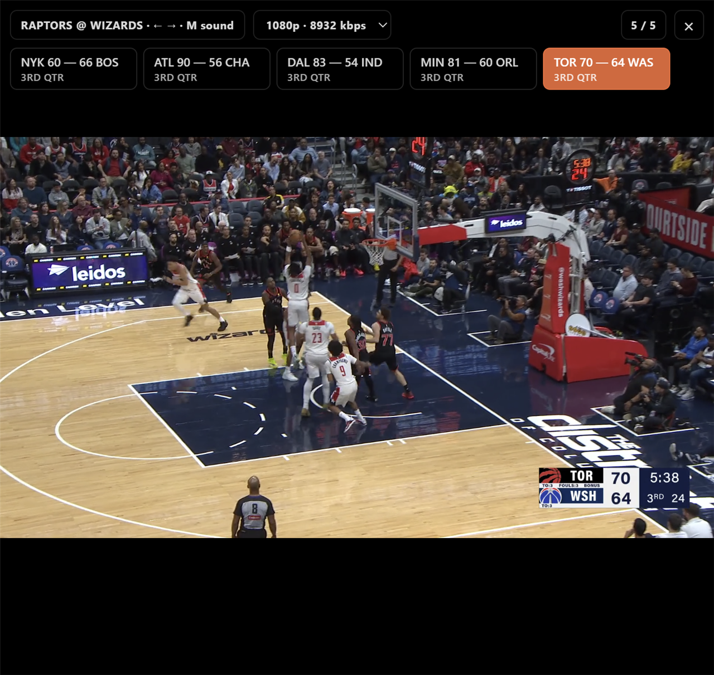

# NBA Carousel

A small Brave / Chromium extension for watching live NBA games in a smooth, full-screen carousel.

Choose your games, switch with the arrow keys, and keep an eye on the other scores. The active stream uses high quality; background streams stay on the lowest available rendition.



## Features

- Select live games from any NBA.com page.
- No extension-imposed four-game cap.
- Smooth **← / →** navigation and clickable live-score cards.
- Highest available quality for the active game; lowest quality for inactive games.
- Independent preferred playback quality for each game.
- Audio follows the active game.
- Live scores and game status refresh every four seconds.
- Uses your existing signed-in NBA session and NBA's playback SDK.
- No local debugging server, build step, or npm dependencies required to use it.

## Requirements

- Brave, Chrome, or another current Chromium-based desktop browser.
- A signed-in NBA account with access to the games you select.
- Protected-media / Widevine playback enabled in your browser.

NBA's entitlement, blackout, license, and account restrictions still apply. This extension does not supply a subscription or redistribute NBA's player or streams.

## Install

1. Clone this repository, or download its ZIP and extract it:

   ```sh
   git clone https://github.com/hemangahuja/nba-carousel.git
   ```

2. Open **`brave://extensions`** or **`chrome://extensions`**.
3. Enable **Developer mode**.
4. Click **Load unpacked** and select the repository folder containing `manifest.json`.
5. Pin **NBA Stream Carousel** to the toolbar if you want quick access.

No build step is needed. After updating the source, click **Reload** on the extension's card.

## Use

1. Open [NBA.com](https://www.nba.com/) and sign in.
2. Click the extension icon.
3. Choose two or more live games and click **Enable Carousel**.
4. The tab opens the first game's watch page to obtain the authenticated player context, then starts an independent player for each selection. You do not need to enable NBA multiview manually.

| Control | Action |
| --- | --- |
| **← / →** | Previous / next selected game |
| **Score card** | Switch directly to that game |
| **M** | Toggle active-game sound |
| **Quality menu** | Set the current game's preferred quality |
| **Esc** or **×** | Close the carousel and restore the underlying page |

Streams start in sequence to avoid a burst of registration and license requests. More selected games need more startup time and browser resources. A quality switch is requested immediately; the visible change depends on the stream's buffered segments.

## Privacy and permissions

- `activeTab` and `tabs`: identify the NBA tab selected by the user.
- `scripting`: install the playback bridge in that NBA page.
- NBA.com host access: read live-game information and run the carousel on NBA pages.

The extension has no added telemetry, developer backend, or credential upload endpoint. NBA and its playback SDK continue to make their normal service requests.

Authentication tokens, CDN signatures, and player context stay in page memory. Only the selected game metadata and a timestamp are temporarily stored in the tab's `sessionStorage` while navigating; that handoff is cleared after startup. The repository contains no captured tokens, cookies, signed manifests, browser profiles, network dumps, or bundled third-party player code.

## How it works

| File | Purpose |
| --- | --- |
| `popup.html`, `popup.js` | Live-game picker and user actions |
| `content.js`, `content.css` | Navigation handoff, carousel, scores, quality and audio policy |
| `background.js` | Installs the main-world bridge into the requesting NBA tab |
| `network-player.js` | Uses NBA's authenticated playback modules for stream selection, MKPlayer, signed requests, Widevine, and session heartbeats |

CDN tokens are refreshed before their reported expiry. Updated page authentication is forwarded to the SDK. Selected transient playback errors get bounded recovery attempts. Extension HTTP requests use ten-second timeouts.

### Compatibility and verification

This is an experimental integration with NBA's internal bundled player modules. Their module IDs and APIs can change, requiring an update.

Tested in Brave with five simultaneous encrypted live games, home-page-to-watch-page navigation, score-card switching, active/background quality changes, and a forced CDN-token refresh. Forced renewal is not an hours-long expiry soak test. The live streams are not synchronized with one another or with the scoreboard feed.

If the picker is empty, check that games are currently live and refresh NBA.com. For a playback error, first check whether the same game works in NBA's own player. Reload the extension and refresh the NBA tab after an extension update.

## Development

Node.js 18+ is only needed for the source checks:

```sh
npm run check
npm run audit:source
```

The source audit checks the publishable file set for common credential formats, local machine paths, email addresses, and work-account identifiers. It is a supplementary check, not a guarantee against every possible secret format.

## License

Extension source is available under the [MIT License](LICENSE). NBA names, game imagery, broadcasts, and third-party software remain the property of their respective owners. This is an independent project and is not affiliated with the NBA.

Built using [Thursday](https://trythursday.org).
